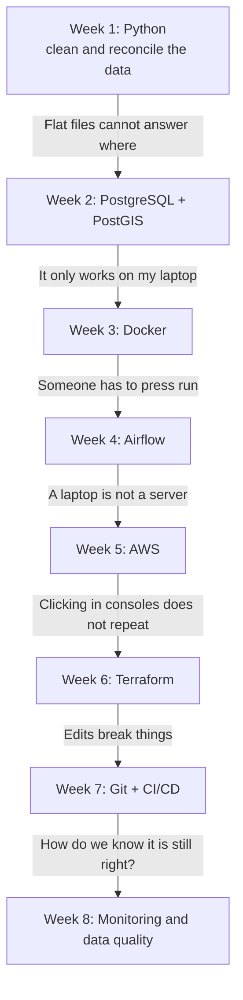

# Boss vs. Data Engineer

**Fibre network edition: an 8-week, build-in-public data engineering series.**

Each week a fictional boss makes a vague demand, my quick fix breaks, and I introduce one new tool to fix one specific problem. Real code, automated tests, and walkthroughs written for beginners.

> **All data in this repository is synthetic.** The boss is fictional. Nothing here comes from any employer, network, or customer.

## The story so far

> **Boss:** "I need a report showing our fibre network incidents, affected locations, downtime, and impacted customers. I need it by tomorrow morning."

No requirements document. Data in three different places. Records that disagree with each other. The series follows what it takes to turn that into something a business can trust.

## The weeks

| Week | The boss says | Focus | Status |
|---|---|---|---|
| [1](week-01-fibre-incidents/) | "A report on incidents, locations, downtime and impacted customers, by tomorrow." | Python and SQL-style logic: clean, reconcile, validate, test | Done |
| 2 | "Show me where they happened." | PostgreSQL and PostGIS | Planned |
| 3 | "It only works on your laptop." | Docker | Planned |
| 4 | "Run it every morning without you." | Apache Airflow | Planned |
| 5 | "Move it off your laptop." | AWS | Planned |
| 6 | "Build the same setup for test and production." | Terraform | Planned |
| 7 | "Stop it breaking when someone edits it." | Git and CI/CD | Planned |
| 8 | "How do we know it is still right?" | Monitoring and data quality | Planned |

The plan may change as the series goes.

### Why each tool arrives when it does

Every week's tool exists because the previous setup hit a wall. That is the whole idea of the series.



This is the plan, not the finished system. The diagrams of the real architecture appear as the pieces get built.

## Start here: Week 1

[Week 1: "The Quick Fix That Wasn't"](week-01-fibre-incidents/README.md) has the setup steps, diagrams, a step-by-step walkthrough of the code, and exercises. In short:

```bash
cd week-01-fibre-incidents
python -m venv .venv
source .venv/Scripts/activate      # Windows (Git Bash). macOS / Linux: source .venv/bin/activate
pip install -r requirements.txt
python pipeline.py                 # build the report
python verify.py                   # check it against the answer key
python -m pytest -v                # run the tests
```

## About the author

**Steve Lawrence**, a network technician practicing data engineering and building in public.

**LinkedIn:** [Steve Lawrence](https://www.linkedin.com/in/steve-lawrence-9b61b22a9/). Follow along there for the weekly posts, and open an issue here with questions or suggestions.

## License

MIT. See [`LICENSE`](LICENSE).

*This is a personal learning project. It uses only synthetic data and contains no information from any employer, network or customer.*
