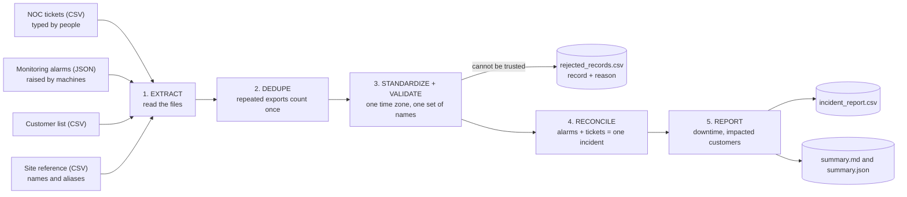
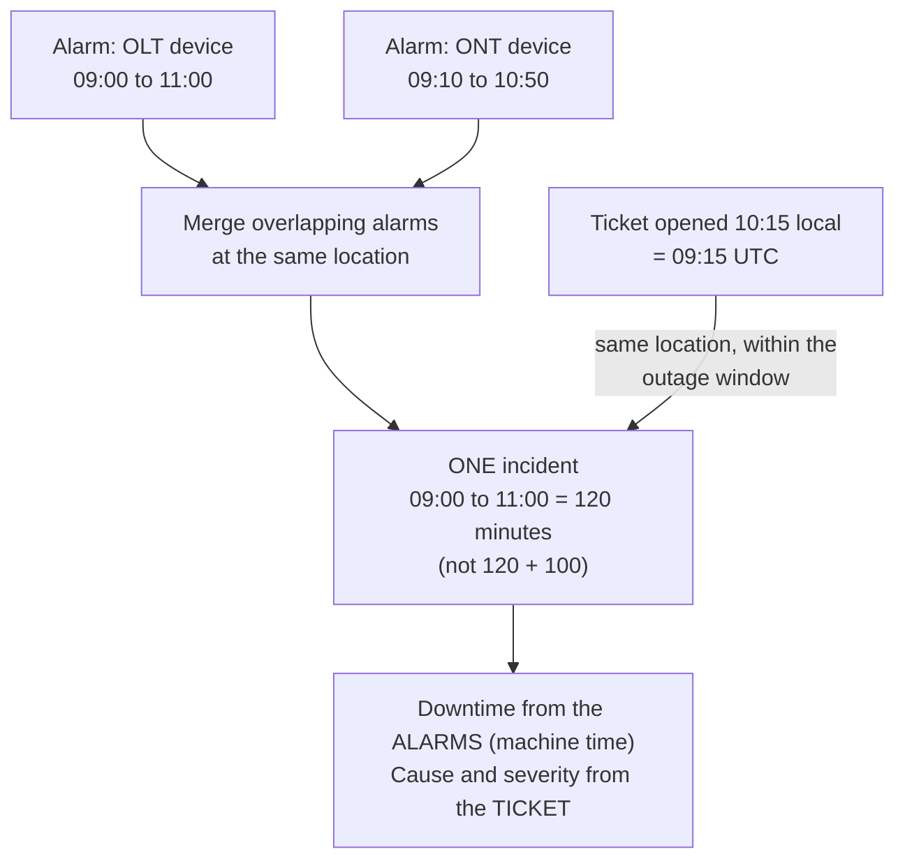

# Fibre Incident Pipeline: Week 1, "The Quick Fix That Wasn't"

> Three messy sources, one vague request, one deadline. This project turns scattered fibre-network records into a report you can trust, and shows exactly where the quick fix goes wrong.

**All data in this repository is synthetic.** It is fictional, generated by `generate_data.py`, and based on no real company, network, location or customer.

Part of **Boss vs. Data Engineer**, an 8-week build-in-public series. Each week a fictional boss makes a vague demand, the quick fix breaks, and one new tool is introduced to fix one specific problem.

---

## The request

> **Boss:** "I need a report showing our fibre network incidents, affected locations, downtime, and impacted customers. I need it by tomorrow morning."

No requirements document. Data in three different places. Records that disagree with each other.

**What you will learn here**
- How to turn a vague request into precise definitions (what *is* an incident? what does "impacted" mean?)
- How to clean data from different systems: time zones, spellings, duplicates, test records
- How to combine two sources that describe the same event, without counting it twice
- Why downtime must be calculated carefully, and how overlapping alarms inflate it
- How to prove your pipeline is right when you know the answer (and why that is a luxury real projects rarely have)

## Table of contents
1. [The data](#1-the-data)
2. [What the quick fix got wrong](#2-what-the-quick-fix-got-wrong)
3. [How it works (the big picture)](#3-how-it-works-the-big-picture)
4. [Quick start](#4-quick-start)
5. [What the report contains](#5-what-the-report-contains)
6. [How the code works, step by step](#6-how-the-code-works-step-by-step)
7. [The rules (definitions and assumptions)](#7-the-rules-definitions-and-assumptions)
8. [Testing](#8-testing)
9. [Limitations](#9-limitations)
10. [The 8-week plan](#10-the-8-week-plan)
11. [Troubleshooting](#11-troubleshooting)
12. [Try it yourself](#12-try-it-yourself)
13. [Glossary](#13-glossary)
14. [About and license](#14-about-and-license)

---

## 1. The data

Four input files live in `data/raw/`. Two of them describe the same outages in different ways, which is the whole problem.

| File | What it is | Who writes it | Why it is messy |
|---|---|---|---|
| `noc_tickets.csv` | The network operations centre's ticket log | People, by hand | Local time in three date formats; location names typed many different ways; repeated exports; test tickets; blanks; free-text customer counts like "approx 59" |
| `monitoring_alarms.json` | Alarms raised by the monitoring system | Machines | UTC time; two devices often report one fault; tiny 1-to-4 minute blips; duplicate records |
| `customers.csv` | Customer list with the location each is connected to | Billing / provisioning | Customers join and leave over time |
| `site_reference.csv` | Official location names, zones, and every known alias | The team | The "memory" that lets us match messy names |

There is also `noc_tickets_sample.csv`, the small, tidy export the quick fix was first written against, and `data/answer_key.json`, the hidden truth the synthetic data was generated from (used only to check the result).

**The synthetic world:** 8 locations, 840 customers, 46 real outages over about a month (3 still ongoing at the cut-off).

---

## 2. What the quick fix got wrong

`naive_report.py` is the quick fix: a short script that reads the ticket log and adds things up.

```bash
python naive_report.py                              # on the small sample: it works
python naive_report.py data/raw/noc_tickets.csv     # on the full export: it crashes
```

The crash is a date format it did not expect. The "quick patch" (`naive_report_patched.py`) is what you write at 11 PM to make the crash go away. Every line looks reasonable. Together they produce confident, wrong numbers:

| | Quick patch | Rebuilt pipeline | Truth (answer key) |
|---|---|---|---|
| Incidents | 49 | **46** | 46 |
| Locations affected | 34 | **8** | 8 |
| Total downtime | 144.8 hours | **192.5 hours** | 192.5 hours |
| Customers impacted | 1,706 | **795 different customers** (4,938 customer-incidents) | 795 (4,938) |

**Why the quick patch is wrong**

- **It trusts one source.** Eight real outages were only seen by the monitoring system, so a ticket-only report never knew about them.
- **It skips what it cannot parse.** That silently drops the ongoing outages (no closing time yet) and unreadable rows.
- **It counts repeats as new events.** Four repeated exports, four test tickets and three second tickets for the same outage were all counted.
- **It counts spelling as geography.** "NORTH RIDGE", "north ridge" and "  North Ridge  " are three "locations", which is how 8 became 34.
- **It treats "approx 59" as zero.** Customer counts typed as text are lost.
- **It does the maths on bad rows.** One ticket closed before it opened, which *subtracts* downtime.

The incident count (49 vs 46) looks close, but only because errors in opposite directions happened to cancel. Matching one number proves nothing.

---

## 3. How it works (the big picture)

Week 1 has no servers, containers or cloud services yet, so there is no infrastructure diagram. These two diagrams show the *logic*: how the data flows, and how several records become one incident. Real architecture diagrams arrive from Week 3, once there are services to draw.



### How several records become one incident



### Text version (if your viewer does not render diagrams)

```
tickets + alarms + customers + site names
   -> extract -> dedupe -> standardize/validate -> reconcile -> report
                                   |
                                   +-> rejected_records.csv (every rejection has a reason)
```

---

## 4. Quick start

**You need:** Python 3.9 or newer (tested on 3.12). The pipeline uses only the standard library. `pytest` is needed for the tests.

**Folder layout** (everything below runs from inside `week-01-fibre-incidents/`):

```
boss-vs-data-engineer/
├── README.md                      series overview
├── .gitignore
└── week-01-fibre-incidents/
    ├── README.md                  you are here
    ├── generate_data.py           creates the synthetic data
    ├── naive_report.py            the quick fix
    ├── naive_report_patched.py    the quick patch
    ├── pipeline.py                the rebuilt pipeline
    ├── verify.py                  checks the result against the answer key
    ├── test_pipeline.py           the tests
    ├── requirements.txt
    ├── data/
    │   ├── raw/                   the four messy inputs (plus the small sample)
    │   └── answer_key.json        the hidden truth, for checking only
    └── example_output/            a sample of what the pipeline produces
```

```bash
# 1. Get the code, then go into this week's folder
git clone https://github.com/LarVinchi/boss-vs-data-engineer.git
cd boss-vs-data-engineer/week-01-fibre-incidents

# 2. Create and activate a virtual environment
python -m venv .venv
source .venv/Scripts/activate      # Windows (Git Bash)
# source .venv/bin/activate        # macOS / Linux

# 3. Install the test tool
pip install -r requirements.txt

# 4. See the quick fix work, then break
python naive_report.py
python naive_report.py data/raw/noc_tickets.csv
python naive_report_patched.py

# 5. Run the rebuilt pipeline
python pipeline.py

# 6. Check it against the hidden answer key
python verify.py

# 7. Run the tests
python -m pytest -v
```

Expected result of step 6:

```text
check                               answer key  pipeline
incidents                                   46        46   OK
ongoing incidents                            3         3   OK
total downtime (minutes)                 11550     11550   OK
distinct customers impacted                795       795   OK
customer-incident impacts                 4938      4938   OK
incidents matching one-by-one               46        46   OK

ALL CHECKS PASS
```

A sample of the output is in `example_output/`. To regenerate the raw data: `python generate_data.py` (it is seeded, so it repeats on the same Python version; the committed files are the reference for the numbers in this README).

**Options**

| Option | Default | What it does |
|---|---|---|
| `--raw FOLDER` | `data/raw` | Where the input files are |
| `--out FOLDER` | `output` | Where the report is written |
| `--as-of TIME` | `2026-11-01T09:00:00Z` | The cut-off. Ongoing outages are measured up to this moment |

---

## 5. What the report contains

### `incident_report.csv`: one row per real outage

| Column | Meaning |
|---|---|
| `incident_id` | `INC-0001`, numbered in time order |
| `site_code`, `location`, `zone` | Where it happened |
| `start_utc`, `end_utc` | Start and end in UTC (end is blank if ongoing) |
| `start_local`, `end_local` | The same in local time (UTC+1) |
| `status` | `resolved` or `ongoing` |
| `downtime_minutes` | Minutes from start to end (or to the cut-off if ongoing) |
| `impacted_customers` | Customers connected to that location that day |
| `severity` | `P1` (critical), `P2` (major) or `P3` (minor) |
| `cause` | Grouped cause, from the ticket (`Unknown (no ticket)` if none) |
| `sources` | `alarm`, `ticket` or `alarm+ticket`: who saw it |
| `ticket_ids`, `alarm_count` | The records that were merged into this incident |
| `quality_flags` | Warnings: `ongoing`, `no_ticket`, `no_alarm`, `multiple_tickets`, `ticket_close_time_ignored` |

### `summary.md` and `summary.json`
The one-page answer for the boss: headline numbers, locations ranked by downtime, causes, how much the inputs can be trusted, and the rules used.

### `rejected_records.csv`
Every record the pipeline would not trust, with the reason. Nothing disappears silently.

---

## 6. How the code works, step by step

`pipeline.py` has five steps, in the order they run.

### Step 1: EXTRACT (`read_csv`, `read_alarms`)
Read the files. If the alarms file is not a list (for example an error message saved to disk), stop with a clear message instead of guessing.

### Step 2: DEDUPE (`dedupe`)
Systems often export the same record twice. This step keeps the first copy of each ticket and alarm id and counts the rest. If a repeated id has *different* content, it is counted as a conflict and reported, because that needs a human.

### Step 3: STANDARDIZE and VALIDATE (`standardize_ticket`, `standardize_alarm`, `standardize_customer`)
Make everything comparable.
- **Time zones.** Tickets are typed in local time (UTC+1) in three formats: `2026-10-13 08:27`, `13/10/2026 08:27`, `13 Oct 2026 8:27 AM`. Alarms are UTC. Everything becomes UTC. Slash dates are read day-first (an assumption you should always confirm).
- **Location names.** Every name is lower-cased and stripped of punctuation, then looked up in the alias table. `"  HARBOUR PT. PHASE 1 "` and `"hp1"` both become `HP1`. A name that is *not* in the table is rejected rather than guessed.
- **Severity words.** `Critical`, `Sev 1`, `P1` all become `P1`.
- **Causes.** Free text is grouped (`"FIBRE CUT - third party excavation"` becomes `Fibre cut`).
- **Validation.** Missing ids, missing or unknown locations, unreadable times, and alarms that clear before they start are rejected with a reason. A ticket that closes before it opens is flagged, and is used only if an alarm can confirm the times.

### Step 4: RECONCILE (`drop_transient_alarms`, `cluster_alarms`, `attach_tickets`, `ticket_only_incidents`, `finish_incident`)
The heart of the project: deciding what counts as *one* incident.
1. **Ignore blips.** Alarms shorter than 5 minutes (or severity 4) are noise.
2. **Merge alarms.** Alarms at the same location that overlap, or sit within 5 minutes of each other, are one outage seen by several devices. Downtime comes from the merged window, so it is never double counted.
3. **Attach tickets.** A ticket joins the outage at its location if it was opened within 30 minutes of that outage's window.
4. **Tickets with no alarm** become incidents of their own (overlapping ones merge).
5. **Pick the times.** Machine alarm times win over typed ticket times. Ongoing outages are measured to the cut-off.
6. **Count impacted customers** from the customer list: those connected at that location on the day the outage started (not the free-text number in the ticket).

### Step 5: REPORT (`summarize`, `write_markdown`, `run`)
Number the incidents in time order, write the CSV, the summary, and the rejects file, and log a one-line result.

---

## 7. The rules (definitions and assumptions)

A vague request becomes a precise one only when you write the definitions down. These are this project's, and each is a decision you could change.

| Question | Rule used | Why |
|---|---|---|
| What is an incident? | One real-world outage at one location, however many records describe it | Otherwise the same outage is counted several times |
| What is a blip? | An alarm under 5 minutes, or severity 4 | Short flaps are noise, not service loss |
| Which time wins? | The alarm's | Machines do not forget to close tickets |
| What is "downtime"? | Minutes from start to end of the merged outage window | Overlaps must not add up |
| What is an ongoing outage? | No clear time yet; measured up to the cut-off | It is still costing the business |
| Who is "impacted"? | Customers connected to that location on the start day | The customer list is more reliable than a typed number |
| Two customer numbers? | Both are reported: different customers, and customer-incidents | The boss may mean either, so say which is which |
| What about unreadable records? | Rejected, with a reason | Never guess, never drop silently |

---

## 8. Testing

```bash
python -m pytest -v
```

65 test cases (38 test functions) run in a fraction of a second and need no internet. They cover:

| Area | What is proven |
|---|---|
| Names | Every known spelling maps to one location; an unknown spelling is not guessed |
| Times | The three ticket formats convert to UTC; day-first is respected; garbage becomes `None` |
| Severity and causes | Different words map to one scale and grouped causes |
| Validation | Each bad ticket or alarm is rejected with a reason |
| Dedupe | Repeats count once; a changed repeat is reported as a conflict; rows with no id are kept for validation |
| Reconcile | Blips ignored; two devices reporting one outage merge; far-apart outages stay separate; tickets attach correctly; overlapping alarms never double count downtime; alarm times win |
| Customers | Only customers active on the day are counted |
| End to end | One outage seen three ways becomes one incident; rejects are listed; reruns give identical files; a bad cut-off or a wrong-shape file stops the run |
| The real test | The full synthetic data matches the hidden answer key, incident by incident |

The tests were also checked by breaking the code on purpose (wrong time zone, blips not ignored, no dedupe, no alarm merging): each change made a test fail.

**Honest caveat:** the data is generated so that every outage is recoverable from at least one source, so a perfect score here is easier than real life. In real projects there is no answer key. You build confidence from reconciling sources against each other, sanity checks, and reading the rejected records.

---

## 9. Limitations

- **Synthetic data.** Real data has problems this does not, and real definitions need agreeing with the people who own them.
- **Everything is in memory and files.** There is no database yet, no history, and no spatial information (Week 2).
- **It only runs when you run it.** Nothing schedules it or alerts anyone (Weeks 3 and 4).
- **The customer list is a snapshot.** It is checked by activation and termination dates, but it does not know about plan changes or moves.
- **Matching is rule-based.** The 30-minute ticket window and 5-minute merge gap suit this data and would need tuning for another network.
- **Alias table upkeep.** A new spelling is rejected until someone adds it. That is intentional, and it is also manual work.

---

## 10. The 8-week plan

This is the plan as it stands. It may change as the series goes.

| Week | The boss says | What breaks | Focus |
|---|---|---|---|
| **1 (this repo)** | "A report on incidents, locations, downtime and impacted customers by tomorrow." | Wrong totals, duplicates, mixed time zones, messy names | SQL-style logic and Python: clean, reconcile, validate, test |
| 2 | "Can we ask questions of this data, and show where things happen?" | Flat files do not answer location questions | PostgreSQL and PostGIS: store it properly, add geography (for example, which customers sit near a damaged cable?) |
| 3 | "It works on your laptop only." | Different machines, different results | Docker: the same environment everywhere |
| 4 | "Run it every morning without you." | Manual runs, silent failures | Apache Airflow: scheduling, retries, alerts |
| 5 | "Move it off your laptop." | Local storage and servers | AWS: cloud storage and database |
| 6 | "Build the same setup for test and production." | Clicking around consoles, drift | Terraform: infrastructure as code |
| 7 | "Stop it breaking when someone edits it." | Untested changes reach production | Git and CI/CD: automated tests and deploys |
| 8 | "How do we know it is still right?" | Data quietly goes bad | Monitoring and data quality, plus a retrospective |

---

## 11. Troubleshooting

| Symptom | Likely cause | Fix |
|---|---|---|
| `ValueError: time data ... does not match format` from `naive_report.py` | The quick fix only knows one date format | That is the point of Step 2. Use `pipeline.py` |
| `FileNotFoundError: data/raw/...` | You are not in the project folder | `cd` into it, or pass `--raw` |
| `ModuleNotFoundError: pytest` | The virtual environment is not active, or tests were not installed | Activate it, then `pip install -r requirements.txt` |
| `--as-of must look like ...` | Cut-off format | Use `2026-11-01T09:00:00Z` |
| `python: command not found` (Windows) | Python is not on your PATH | Try `py` instead of `python` |
| Numbers differ from this README | You regenerated the data on another Python version, or changed the data or the rules | Use the committed files in `data/`, or compare against your own regenerated `data/answer_key.json` with `python verify.py` |

---

## 12. Try it yourself

1. **Find the five wrong numbers.** Run `naive_report_patched.py` and the pipeline. For each difference, find the line in the quick patch that causes it.
2. **Change a definition.** Make blips 10 minutes instead of 5. What changes in the report, and which test breaks?
3. **Add a spelling.** Add a new alias to `site_reference.csv`. Which rejected ticket now joins an incident?
4. **Break the data on purpose.** Add a ticket with a date like `2026-10-40 09:00`. Where does it end up, and why?
5. **Add a column.** Add `customers_per_downtime_hour` to the report. Write the test first.
6. **Think about definitions.** Should planned maintenance count as an incident? Write down your rule, change the code, and defend it.

---

## 13. Glossary

| Term | Plain-English meaning |
|---|---|
| **Incident** | One real-world outage, however many records describe it |
| **Downtime** | How long service was lost |
| **Impacted customer** | A customer connected to an affected location during an outage |
| **NOC** | Network operations centre: the team that watches the network |
| **OLT / ONT** | Fibre equipment at the provider's end and the customer's end |
| **Alarm** | An automatic message from monitoring that something is wrong |
| **Ticket** | A record a person writes about a problem |
| **UTC and local time** | UTC is the world's reference clock; local time is UTC plus an offset |
| **Standardize** | Make different spellings and formats look the same |
| **Validate** | Check that data meets rules before trusting it |
| **Dedupe** | Remove repeats |
| **Reconcile** | Combine records from different sources that describe the same thing |
| **Idempotent** | Running it twice gives the same result as running it once |
| **Fixture / synthetic data** | Made-up data used for testing and learning |
| **Answer key** | The known-correct result, available only because the data is synthetic |

---

## 14. About and license

**Author:** Steve Lawrence, a network technician practicing data engineering and building in public.
**LinkedIn:** [Steve Lawrence](https://www.linkedin.com/in/steve-lawrence-9b61b22a9/) | **Series:** Boss vs. Data Engineer

Feedback and questions are welcome: open an issue or comment on the LinkedIn post.

**License:** MIT. See the [`LICENSE`](../LICENSE) file at the root of the repository.

*This is a personal learning project. It uses only synthetic data and contains no information from any employer, network or customer.*
